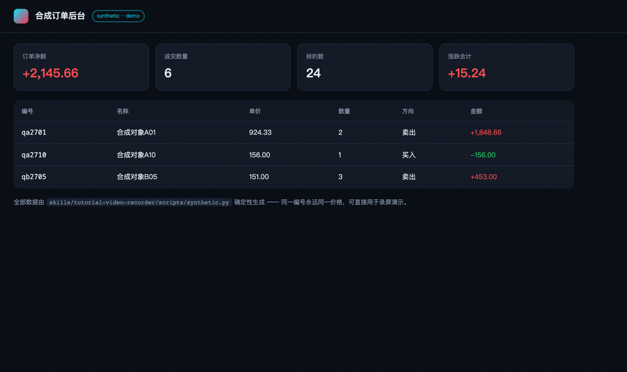

<div align="center">

# agent-skills

**Framework-agnostic agent skills that ship real work.**

Record a tutorial video of a **real running web app** — with **zero real data** on screen.
One config file + one adapter to plug in any app.

[](https://skills.sh/a6749267/agent-skills)


[English](README.md) · [中文](README.zh-CN.md) · [Install](#install) · [Why](#why-this-is-hard) · [Skills](#skills)

</div>


<div align="center">
  
</div>

---

## The problem

You want a tutorial video of your app. So you open Playwright and hit record.

Ten minutes later you have 4 minutes of video with **your production data on screen** —
real customer names, real order numbers, real account balances. And your "totals don't
match the line items" bug is baked into the frame.

Most tools solve one of these:

| Tool | Records? | De-identifies? |
|---|---|---|
| Playwright `record_video` | ✅ | ❌ |
| Loom / screen recorders | ✅ | ❌ |
| Post-hoc blur / mosaic | — | ⚠️ partial, and it's manual |

**This repo is the missing third thing: record *and* de-identify, in the same pass,
with the guarantee that the numbers on screen are still self-consistent.**

> **Found this useful?** ⭐ Star the repo — it takes one click and it's the only way other
> people find it. New skills land in the same repo over time.

---

## Why this is hard

Naive de-identification breaks your video. Three things go wrong, and all three are
silent — no exception, no crash, just a wrong-looking frame:

**1. The frontend renders a total that doesn't equal the sum of its line items.**
Real backends often hardcode the summary field to `0` while the frontend recomputes it
from the line items. Now your video shows `+0.00` in the header and `−1200.00` in the
table. Every number is "real-looking", and a viewer spots the contradiction in two seconds.

**2. A vision model reads your numbers wrong — and then argues with you.**
At thumbnail resolution, a model reads `−1200.00` as `−1400.00`, computes
"three lines sum to −1600, the header says −1400, these don't match" — and questions
*correct* data. A **false inconsistency is more expensive than a real one**, because it
sends you off to "fix" something that was never broken.

**3. The real value is still in the JavaScript bundle.**
DOM scrubbing can't reach a hardcoded string inside `app.js`. It renders on screen.

**This repo handles all three by construction:**

- **L1 / L2 / L3 interception** — scrub the JS bundle, replace data-API responses
  wholesale, and recompute summary fields from the same synthetic source.
- **Native OCR, amplified** — frames are upscaled 2× before being read, and the
  **source formula** cross-checks the OCR reading. Numbers are verified twice,
  by two independent paths.
- **Full-frame OCR sweep** — every frame at 2fps, not a sample. A leak at second 7
  doesn't show up in a spot check.

📖 All 40+ pitfalls, indexed by symptom: [`references/pitfalls.md`](skills/tutorial-video-recorder/references/pitfalls.md)

---

## What's in the box

```
agent-skills/
├── skills/
│   ├── tutorial-video-recorder/   # record → synthesize → silent.mp4
│   └── tutorial-video-post/       # subtitles → BGM → verify → de-identify
├── docs/                           # methodology & release checklist
├── demo/                           # a runnable synthetic dashboard
└── skills.sh.json                  # Skills Hub grouping
```

| Skill | What it does | Output |
|---|---|---|
| [`tutorial-video-recorder`](skills/tutorial-video-recorder/) | Record a real app, replace all data with synthetic, guarantee summary == sum of details | `silent.mp4` |
| [`tutorial-video-post`](skills/tutorial-video-post/) | Burn subtitles, pick and mix BGM, verify audio, sweep for leaks | `final.mp4` |

**Framework-agnostic.** Standard `SKILL.md` directory layout — works with Claude Code,
Cursor, Codex, Copilot, Windsurf, Gemini CLI, OpenClaw, Hermes, and anything else that
reads a skill directory. Runtime paths resolve through an environment-variable priority
chain; nothing hardcodes one framework's layout.

---

## Install

```bash
# one command, all skills
npx skills add a6749267/agent-skills
```

<details>
<summary>Behind a firewall / restricted network? Use the SSH URL instead</summary>

`npx skills add` clones over HTTPS. If your network blocks `github.com:443`, use the SSH
remote — the `skills` CLI accepts any git URL:

```bash
npx skills add git@github.com:a6749267/agent-skills.git
```

You need an SSH key registered on your GitHub account
([Settings → SSH keys](https://github.com/settings/keys)). Nothing about the skill
changes — it is the same repository.
</details>

Or copy a skill directory into your agent's skills folder:

```bash
cp -r skills/tutorial-video-recorder  <your-agent-skills-dir>/tutorial-video-recorder
cp -r skills/tutorial-video-post      <your-agent-skills-dir>/tutorial-video-post
```

**Requirements:** `ffmpeg` + `playwright` (`pip install playwright && playwright install chromium`).
Model-based scoring (AST/CLAP) additionally needs `torch transformers numpy`.

Self-check your install:

```bash
bash skills/tutorial-video-recorder/scripts/install.sh
python skills/tutorial-video-recorder/scripts/selfcheck.py --verbose
```

The self-check runs 13 assertions. This matters more than it sounds: **this pipeline's
failures don't raise exceptions** — they turn into "header total ≠ sum of line items",
which looks like plausible data. Eyeballs don't catch it. Your audience does, instantly.

---

## Quick start

### 1. Configure

```bash
cp skills/tutorial-video-recorder/assets/templates/project.json ./project.json
cp skills/tutorial-video-recorder/assets/templates/script.json    ./script.json
```

Three things to change:

| Where | What |
|---|---|
| `project.json` → `app` | your app URL, login, and one entry per narrated segment |
| `project.json` → `domain` | which domain config describes your app's data |
| `project.json` → `business_paths` | your app's business API paths (fnmatch wildcards supported) |

### 2. Describe your data

```bash
cp skills/tutorial-video-recorder/assets/domains/generic.json my_domain.json
```

```json
{
  "real_code_prefixes": ["sku", "ord"],
  "real_display_names": ["Widget Alpha", "Customer Beta"],
  "org_map": { "Acme Corp": "Synthetic Org A" },
  "id_shape": { "pattern": "^[0-9]{4}$", "prefix_len": 2, "year_digit": "2", "seq_min": 1, "seq_max": 12 }
}
```

> The authority on what counts as "real" is **what your app actually contains** —
> never a generic wordlist shipped with the tool.

### 3. Write an adapter

```bash
cp -r skills/tutorial-video-recorder/scripts/adapters/ecommerce_demo \
      scripts/adapters/my_app
```

Two methods:

```python
class Adapter:
    def route(self, url):
        """Return (status, body) to replace this response; None = pass through."""
        if url.split("?")[0].endswith("/api/market/quotes"):
            return 200, self._shape_quotes(self.quotes())
        return None

    def fix_summary(self, url, payload, scfg):
        """Recompute the header total from the same data the table uses."""
        return payload
```

**Structure must match the real response exactly.** One mismatched field and your
frontend renders an empty state instead of your data.

### 4. Run

```bash
SKILL=skills/tutorial-video-recorder
python $SKILL/scripts/recorder.py --config project.json
python $SKILL/scripts/compose.py  --config project.json
```

Then post-process:

```bash
POST=skills/tutorial-video-post
python $POST/scripts/subtitle_post.py --align align.json --script script.json \
    --timeline timeline.json --video silent.mp4 --out with_subs.mp4
python $POST/scripts/mix_bgm.py  --bgm music.mp3 --silent with_subs.mp4 \
    --timeline timeline.json --out final.mp4
python $POST/scripts/verify_audio.py final.mp4 --silent silent.mp4 --timeline timeline.json
python $POST/scripts/scan_leak.py final.mp4 --ocr --transcribe
```

---

## Design notes

### Three interception layers — one is never enough

| Layer | Handles | If you only did this |
|---|---|---|
| **L1** JS bundle | real literals hardcoded in the frontend | real IDs still appear on screen (DOM scrub can't reach them) |
| **L2** data APIs | replaces the whole response with synthetic payload | real prices/quantities/details all leak |
| **L3** business APIs | passes the real backend through, scrubs fields, recomputes summaries | real account on screen; header contradicts its own table |

### No app assumptions in the generic layer

Every app-specific path, cache key, and domain wordlist lives in config:

| Thing | Where |
|---|---|
| Business API paths | `project.json` → `business_paths` (fnmatch wildcards) |
| Frontend cache keys | `project.json` → `storage_keys_block` |
| Domain wordlists | `assets/domains/<name>.json` |
| ID shape | `assets/domains/<name>.json` → `id_shape` |
| Table/column names | `project.json` → `db.schema` |

### The non-obvious bits

- **Use full Chromium**, never `headless_shell` — the latter has no screencast support.
- **One browser context per segment** — clean state at each segment boundary.
- **Disable the HTTP cache** — a warm cache silently defeats all interception.
- **One interception implementation**, shared by recording and verification.
- **Numbers must be read by native OCR, not by a vision model** — see the pitfall above.
- **Hex colors are not IDs** — `#ef4444` is CSS red; guarding on it corrupts the UI.

---

## Cross-framework adaptation

All runtime resolution is centralized in
`skills/tutorial-video-recorder/scripts/agentenv.py`, which tries a priority chain.

| Variable | Purpose | Fallback |
|---|---|---|
| `TUTORIAL_PYTHON` | interpreter that runs the pipeline | `$PY` → agent home venv → `python3` |
| `TUTORIAL_ENV_FILE` | credentials file | `$AGENT_HOME/.env` → `~/.env` |
| `AGENT_HOME` | agent runtime root | — |
| `TUTORIAL_SKILL_HOME` | skill root | two levels up from the script itself |

### Why not `Path.home()`

> Agent sandboxes often hijack `$HOME` to their own sandbox home. The real home
> directory — and the real credentials file — live elsewhere. `Path.home()` returns
> the sandbox path → file not found → **credentials silently missing**, no error,
> hardest possible bug to diagnose.

`agentenv.real_home()` reverse-derives the real home from the resolved `python3` path
on `PATH`, then falls back to `expanduser("~")`.

### Minimal requirement for your own skill

1. a `SKILL.md` with YAML frontmatter (`name` must match the directory name)
2. a `scripts/` directory next to it

---

## Dependency tiers

Different scripts need different packages — **don't assume one venv has everything**:

| Scripts | Needs |
|---|---|
| `fetch_music.py` / `mix_bgm.py` / `scan_leak.py` | stdlib (+ ffmpeg), **zero deps** |
| `select_segments.py` / `verify_audio.py` | numpy |
| `subtitle_post.py` | pillow |
| `music_identify.py` / `ast_tags.py` / `clap_score.py` | torch + transformers |

Model scoring (AST/CLAP) and Whisper verification usually need **two different
interpreters**. Probe them one at a time: `python -c "import transformers"` /
`python -c "import faster_whisper"`.

---

## De-identification

**Run before every release:**

```bash
python skills/tutorial-video-post/scripts/scan_leak.py publish_copy.md
python skills/tutorial-video-post/scripts/scan_leak.py final.mp4 --ocr --transcribe
```

Exit code 0 means clean.

Your own private patterns go in `assets/leak_patterns.json` — **the tool hardcodes
nobody's private identity**:

```json
{
  "block": [["Your Private Project", "private project"]],
  "warn":  [["Some Lookalike", "custom"]]
}
```

Allowlist goes in `leak_allow.txt` (one regex per line).

---

## Contributing

Contributions are welcome — especially **adapters for new apps**. Drop one in
`skills/tutorial-video-recorder/scripts/adapters/<your_app>/` and open a PR.

Before you push:

```bash
python skills/tutorial-video-recorder/scripts/selfcheck.py
python skills/tutorial-video-post/scripts/scan_leak.py <your files>
```

See [`CONTRIBUTING.md`](CONTRIBUTING.md).

---

## License

MIT — see [LICENSE](LICENSE).
