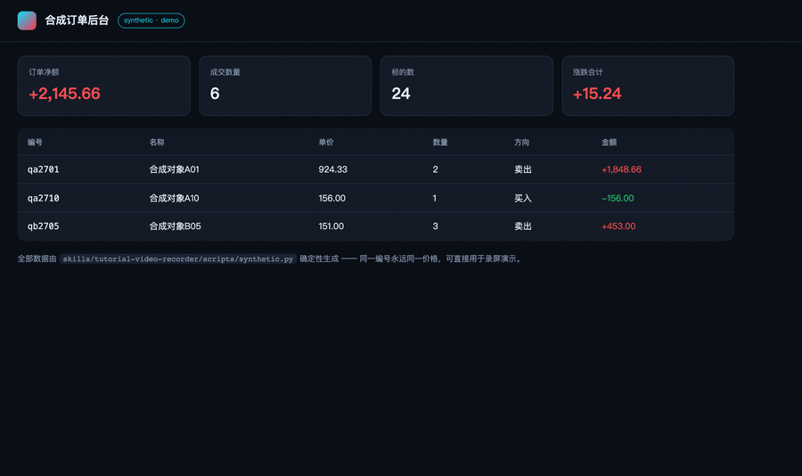

<div align="center">

# agent-skills

**框架无关的 agent skill —— 干真活的。**

把**真实运行的 web 应用**录成教程视频，同时保证**画面里没有一个真实数据**。
改一份配置 + 写一个 adapter，就能接任意 app。

[](https://skills.sh/a6749267/agent-skills)


[English](README.md) · [中文](README.zh-CN.md) · [安装](#安装) · [为什么难](#为什么这事难) · [Skills](#仓库里有什么)

</div>


<div align="center">
  
</div>

---

## 问题在哪

你想给自己的 app 录个教程视频。于是打开 Playwright 开始录。

十分钟后你得到 4 分钟视频，画面上是**生产环境真实数据** —— 真实客户名、真实订单号、
真实账户余额。而且「顶栏汇总 ≠ 明细之和」的那个 bug 也一起录进去了。

现有工具只解决其中一半：

| 工具 | 能录屏？ | 能脱敏？ |
|---|---|---|
| Playwright `record_video` | ✅ | ❌ |
| Loom / 系统录屏 | ✅ | ❌ |
| 事后打码 / 马赛克 | — | ⚠️ 不彻底，而且全靠手动 |

**这个仓库补的是缺的那第三样：边录边脱敏，同一遍完成，并且保证画面上的数字
仍然自洽。**

---

## 为什么这事难

朴素的脱敏会把视频搞坏。三个坑，**全都不报错** —— 不抛异常、不崩溃，只给你一帧
看起来不对的画面：

**1. 前端渲染的「总计」和它自己的「明细之和」对不上。**
真实后端经常把汇总字段硬编码成 `0`，而前端用明细自己算。
于是视频里顶栏写 `+0.00`、表格里写 `−1200.00`。每个数字都"看着像真的"，
观众两秒就能看出矛盾。

**2. vision 模型会把你画面上的数字读错 —— 然后反过来质疑你。**
缩略图分辨率下，模型把 `−1200.00` 读成 `−1400.00`，自己算出
"三笔之和 −1600，顶栏 −1400，对不上"，然后开始怀疑**本来正确**的数据。
**假的不一致比真的不一致更贵** —— 因为它会让你去"修"一个从没坏过的东西。

**3. 真实值还藏在 JS bundle 里。**
DOM 洗不掉 `app.js` 里硬编码的字符串，但它照样渲染到屏幕上。

**这个仓库从结构上解决这三个：**

- **L1 / L2 / L3 三层拦截** —— 洗 JS bundle、数据类接口整个响应替换、
  业务接口字段级清洗 + 汇总重算。
- **原生 OCR + 放大** —— 抽帧放大 2× 再读，并且用**源头算式**和 OCR 读数
  双向交叉验证。数字走两条独立路径验两遍。
- **全片 OCR 盲扫** —— 每帧 @2fps，不是抽查。泄漏可能发生在第 7 秒。

📖 全部 40+ 个坑，按症状索引：[`references/pitfalls.md`](skills/tutorial-video-recorder/references/pitfalls.md)

---

## 仓库里有什么

```
agent-skills/
├── skills/
│   ├── tutorial-video-recorder/   # 录制 → 合成 → silent.mp4
│   └── tutorial-video-post/       # 字幕 → 配乐 → 验收 → 脱敏
├── docs/                           # 方法论与发布检查清单
├── demo/                           # 可运行的合成 dashboard
└── skills.sh.json                  # Skills Hub 分组
```

| Skill | 干什么 | 交付 |
|---|---|---|
| [`tutorial-video-recorder`](skills/tutorial-video-recorder/) | 录真实 app，数据全换合成，保证「汇总 == 明细之和」 | `silent.mp4` |
| [`tutorial-video-post`](skills/tutorial-video-post/) | 烧字幕、选曲混音、音频验收、全片扫泄漏 | `final.mp4` |

**框架无关。** 标准 `SKILL.md` 目录结构 —— Claude Code / Cursor / Codex / Copilot /
Windsurf / Gemini CLI / OpenClaw / Hermes 以及任何能读 skill 目录的框架都能用。
运行时路径走环境变量优先级链，**不硬编码任何一家框架的目录布局**。

---

## 安装

```bash
# 一条命令装全部
npx skills add a6749267/agent-skills
```

或者直接复制 skill 目录：

```bash
cp -r skills/tutorial-video-recorder  <你的-agent-skills-dir>/tutorial-video-recorder
cp -r skills/tutorial-video-post      <你的-agent-skills-dir>/tutorial-video-post
```

依赖：`ffmpeg` + `playwright`（`pip install playwright && playwright install chromium`）。
模型打分（AST/CLAP）另需 `torch transformers numpy`。

装完自检：

```bash
bash skills/tutorial-video-recorder/scripts/install.sh
python skills/tutorial-video-recorder/scripts/selfcheck.py --verbose
```

自检跑 13 项。这件事比听起来重要：**这条管线的失败不会抛异常** —— 它变成
「顶栏汇总 ≠ 明细之和」这种看起来还挺像回事的假数据。肉眼发现不了，观众一眼看穿。

---

## 快速开始

### 1. 配

```bash
cp skills/tutorial-video-recorder/assets/templates/project.json ./project.json
cp skills/tutorial-video-recorder/assets/templates/script.json    ./script.json
```

三处要改：

| 改哪 | 改什么 |
|---|---|
| `project.json` → `app` | app 地址、登录信息、每段路由与旁白 |
| `project.json` → `domain` | 用哪个领域配置描述你的 app |
| `project.json` → `business_paths` | 你的业务接口路径（支持 fnmatch 通配） |

### 2. 写你的领域配置

```bash
cp skills/tutorial-video-recorder/assets/domains/generic.json my_domain.json
```

```json
{
  "real_code_prefixes": ["sku", "ord"],
  "real_display_names": ["商品名甲", "客户乙"],
  "org_map": { "你的机构名": "合成机构A" },
  "id_shape": { "pattern": "^[0-9]{4}$", "prefix_len": 2, "year_digit": "2", "seq_min": 1, "seq_max": 12 }
}
```

> 判定的权威永远是「你的 app 真实存在什么」，不是任何通用词表。

### 3. 写 adapter

```bash
cp -r skills/tutorial-video-recorder/scripts/adapters/ecommerce_demo \
      scripts/adapters/my_app
```

只需两个方法：

```python
class Adapter:
    def route(self, url):
        """返回 (status, body) 替换这个响应; None = 不管"""
        if url.split("?")[0].endswith("/api/market/quotes"):
            return 200, self._shape_quotes(self.quotes())
        return None

    def fix_summary(self, url, payload, scfg):
        """用表格同一套数据重算顶栏汇总"""
        return payload
```

**结构必须和真响应一模一样** —— 一个字段对不上，前端就渲染成「暂无」空态。

### 4. 跑

```bash
SKILL=skills/tutorial-video-recorder
python $SKILL/scripts/recorder.py --config project.json
python $SKILL/scripts/compose.py  --config project.json
```

后期：

```bash
POST=skills/tutorial-video-post
python $POST/scripts/subtitle_post.py --align align.json --script script.json \
    --timeline timeline.json --video silent.mp4 --out with_subs.mp4
python $POST/scripts/mix_bgm.py  --bgm music.mp3 --silent with_subs.mp4 \
    --timeline timeline.json --out final.mp4
python $POST/scripts/verify_audio.py final.mp4 --silent silent.mp4 --timeline timeline.json
python $POST/scripts/scan_leak.py final.mp4 --ocr --transcribe
```

---

## 设计要点

### 三层拦截 —— 一层都不够

| 层 | 处理什么 | 只做这层的后果 |
|---|---|---|
| **L1** JS bundle | 前端硬编码的真实字面量 | bundle 里的真编号照样上屏（DOM 洗不掉） |
| **L2** 数据类 API | 整个响应替换成合成 payload | 真实价格/数量/明细全泄漏 |
| **L3** 业务类 API | 放行真后端 + 字段级清洗 + 汇总重算 | 真账户上屏；顶栏和明细自相矛盾 |

### 通用层不含任何 app 假设

app 相关的路径、缓存键、领域词表**全在配置里**：

| 东西 | 在哪 |
|---|---|
| 业务接口路径 | `project.json` → `business_paths`（支持 fnmatch 通配） |
| 前端缓存键 | `project.json` → `storage_keys_block` |
| 领域词表 | `assets/domains/<name>.json` |
| 编号形状 | `assets/domains/<name>.json` → `id_shape` |
| 表名/字段名 | `project.json` → `db.schema` |

### 几个不显然但重要的点

- **必须用完整 Chromium**，不能用 `headless_shell` —— 后者不支持 screencast。
- **每段一个独立 context** —— 段首状态干净，不互相污染。
- **关掉 HTTP 缓存** —— 缓存命中会让拦截完全失效。
- **拦截逻辑只能有一份**，录制和验收共用。
- **数字必须用原生 OCR 读**，不用 vision 读 —— 见上面的坑。
- **hex 颜色不是编号** —— `#ef4444` 是 CSS 颜色，不守会把前端配色全改坏。

---

## 跨框架适配

所有运行时解析集中在
`skills/tutorial-video-recorder/scripts/agentenv.py`，走**优先级链**逐个尝试。

| 变量 | 作用 | 默认回退 |
|---|---|---|
| `TUTORIAL_PYTHON` | 跑管线的解释器 | `$PY` → agent home 下的 venv → `python3` |
| `TUTORIAL_ENV_FILE` | 凭据文件 | `$AGENT_HOME/.env` → `~/.env` |
| `AGENT_HOME` | agent 运行时根目录 | — |
| `TUTORIAL_SKILL_HOME` | skill 根目录 | 脚本自身位置上溯两级 |

### 为什么不用 `Path.home()`

> agent 沙箱常把 `$HOME` 劫持成自己的沙箱家目录。真正的家目录和凭据文件在别处。
> `Path.home()` 拿到沙箱路径 → 文件不存在 → **静默拿不到 key**，不报错，最难查。

`agentenv.real_home()` 从 PATH 上 `python3` 的真实路径**反推**家目录，再退回
`expanduser("~")`。

### 自己装 skill 时的最小要求

1. 目录里有 `SKILL.md`（YAML frontmatter，`name` 必须与目录名一致）
2. `scripts/` 与 `SKILL.md` 同级

---

## 依赖分层

不同脚本要不同的包，**别假设一个 venv 全都有**：

| 脚本 | 需要 |
|---|---|
| `fetch_music.py` / `mix_bgm.py` / `scan_leak.py` | 标准库（+ffmpeg）**零依赖** |
| `select_segments.py` / `verify_audio.py` | numpy |
| `subtitle_post.py` | pillow |
| `music_identify.py` / `ast_tags.py` / `clap_score.py` | torch + transformers |

模型打分（AST/CLAP）和 Whisper 验收通常需要**两个不同解释器**。逐个试：
`python -c "import transformers"` / `python -c "import faster_whisper"`。

---

## 脱敏

**发布前必跑：**

```bash
python skills/tutorial-video-post/scripts/scan_leak.py publish_copy.md
python skills/tutorial-video-post/scripts/scan_leak.py final.mp4 --ocr --transcribe
```

退出码 0 才发。

你自己的私有词放 `assets/leak_patterns.json` —— 脚本**不硬编码任何人的私密身份**：

```json
{
  "block": [["你的私有项目名", "私有项目"]],
  "warn":  [["某个易混淆的词", "自定义"]]
}
```

白名单放 `leak_allow.txt`（每行一个正则，命中即放行）。

---

## 参与贡献

欢迎贡献 —— 尤其欢迎**新 app 的 adapter**。放进
`skills/tutorial-video-recorder/scripts/adapters/<your_app>/` 并提 PR 即可。

推之前先跑：

```bash
python skills/tutorial-video-recorder/scripts/selfcheck.py
python skills/tutorial-video-post/scripts/scan_leak.py <你的文件>
```

详见 [`CONTRIBUTING.md`](CONTRIBUTING.md)。

---

## License

MIT —— 见 [LICENSE](LICENSE)。
